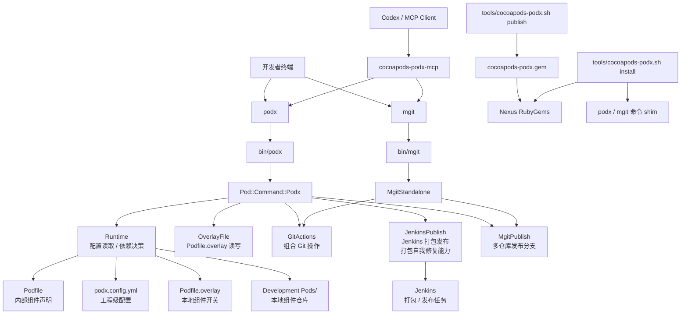

# cocoapods-podx

`cocoapods-podx` 是面向工程协作的 AI 指令服务。它把依赖治理、多仓库 Git、发布触发、AI 辅助分析和团队规则沉淀到统一的 `podx` / `mgit` 命令体系中。

CocoaPods 只是其中一类被托管的工程能力，文档重点放在完整工程流程和 AI 指令服务上。

## 能力范围

- `podx`：工程命令入口，覆盖依赖安装、overlay 本地/远端切换、工程诊断、打开工程、发布触发和 AI 初始化。
- `mgit`：多仓库 Git 入口，覆盖 branch、status、diff、log、add、pull、push、commit、checkout、stash、publish。
- `podx ai`：生成 Claude Code 项目结构，接入 CodeGraph / Code Review Graph，沉淀 rules、skills、agents、commands、mcps。
- MCP：向 Codex 等 AI 客户端暴露受控的 `podx` / `mgit` 能力。
- 安装脚本：安装、卸载、发布 gem，并生成 `podx` / `mgit` 命令。

Hermes Agent 与 iOS DevOps 的组合方案见 [HERMES_IOS_DEVOPS.md](HERMES_IOS_DEVOPS.md)。

## 设计目标

- 不频繁修改主工程 `Podfile`，通过 `Podfile.overlay` 切换组件本地源码。
- 官方 `pod` 语义保持可用，`podx install` / `podx update` 只在必要时增加工程前置处理。
- 多仓库操作统一通过 `mgit` 执行，减少手工切分支、提交、拉取和发布分支的重复操作。
- 发布命令只发布远端分支 HEAD，不发布本地未提交代码。
- AI 配置统一放在 `.claude/` 下，形成团队一致的开发、测试、发布和评审规则。
- 工程私有地址、账号、令牌、发布服务地址都应放在本地配置或环境变量中，不写入 README。

## 整体架构



核心分层：

- 命令入口层：`bin/podx`、`bin/mgit`，把用户命令转换为插件动作或原生工具语义。
- CocoaPods 插件层：`Pod::Command::Podx`，统一调度依赖切换、工程诊断、发布和打开工程。
- Runtime 层：读取 `podx.config.yml`、解析主 `Podfile`，决定组件走本地 `:path` 还是远端 `:git/:branch`。
- 功能模块层：`OverlayFile`、`GitActions`、`MgitPublish`、`JenkinsPublish`，分别处理文件、Git、多仓发布和 Jenkins 打包。
- MCP 集成层：`cocoapods-podx-mcp`，向 Codex 暴露受控的 `podx` / `mgit` 能力。
- 安装发布层：`tools/cocoapods-podx.sh` 及底层脚本，负责 gem 安装、卸载、发布和命令 shim 生成。

## 安装

在工程目录执行：

```bash
sh tools/cocoapods-podx.sh install
```

指定版本：

```bash
sh tools/cocoapods-podx.sh install 0.0.10
```

本地源码编译安装，不发布、不访问 Nexus：

```bash
sh tools/cocoapods-podx.sh install-local
```

卸载：

```bash
sh tools/cocoapods-podx.sh uninstall
```

验证：

```bash
podx version
podx help
mgit branch
```

安装脚本会优先安装到当前 CocoaPods 使用的 RubyGems 环境。没有 CocoaPods 的机器会进入 publish-only 模式，仍可使用 `podx publish --job ...`、`podx ai ...` 和 `mgit ...`。

## 依赖环境

基础环境：

- macOS：用于 iOS 工程、Xcode、CocoaPods 和 `open` 等系统能力。
- Ruby / RubyGems：用于运行 `cocoapods-podx` gem、构建 gem、安装命令 shim。
- CocoaPods：用于 `podx install`、`podx update`、`pod podx` 等 CocoaPods 插件能力。
- Git：用于 `mgit`、本地组件仓库、发布分支和远端 commit 信息查询。
- Node.js：仅 MCP 服务需要，用于运行 `cocoapods-podx-mcp/server.js`。

发布和 CI 环境：

- Nexus RubyGems 仓库：存放 `cocoapods-podx-*.gem`，供团队安装和升级。
- Jenkins：供 `podx publish` 触发打包、查询历史、拉取日志、分析失败和执行维护 job。
- Hermes：可选，用于 Jenkins 失败日志二次分析和发布经验沉淀。
- Xcode / xcodebuild：仅 iOS 打包机或本地编译需要。

环境变量建议：

- `COCOAPODS_PODX_GEM_SOURCE`：覆盖插件 gem 下载/发布源。
- `COCOAPODS_PODX_VERSION`：安装时指定插件版本。
- `GEM_HOST_API_KEY`：发布 gem 到私有 RubyGems 仓库时使用。
- `COCOAPODS_PODX_AUTO_FIX_RETRY`：控制 Jenkins 自动修复后的自动重试。
- `COCOAPODS_PODX_HERMES_EVOLUTION`：控制发布失败后的 Hermes 经验沉淀。
- `COCOAPODS_PODX_FAILURE_CASE_DB`：Jenkins 失败案例库路径，默认 `~/.cocoapods-podx/jenkins_failure_cases.jsonl`；设置为 `0` 可关闭。

README 不记录任何内网地址、账号、token、证书或具体 Jenkins URL；这些信息应由本地环境变量、CI/CD 配置或团队私有文档维护。

## 接入工程

在主 `Podfile` 中引入：

```ruby
require 'cocoapods-podx'

CocoapodsPodx::Runtime.configure(project_directory: __dir__)

source CocoapodsPodx::Runtime.private_source
```

初始化工程配置：

```bash
podx init
```

生成的 `podx.config.yml` 只保存工程级配置，例如 specs 源、Git 根地址、发布工作目录、多仓库发布列表等。具体地址和账号信息请按团队规范在本地配置或环境变量中维护。

## 依赖声明

内部组件也使用官方 `pod` 声明，通过参数交给 `podx` 管理：

```ruby
pod 'NNApperance', :branch => 'develop'
pod 'NNLibrary', :branch => 'develop', :remote_name => 'NNYYText', :local_name => 'NNLibrary'
pod 'NNLogin', :branch => 'develop', :group_name => 'NNBussCom'
```

常用参数：

- `:branch`：远端分支，也是本地分支校验的回退值。
- `:group_name`：多个 pod 共用一个业务仓库时使用。
- `:remote_name`：远端仓库名和 pod 名不一致时使用。
- `:local_name`：本地目录名和 pod 名不一致时使用。
- `:configurations`：透传给 CocoaPods。
- `:custom_git_target`：远端仓库不在默认分组时使用。

## Podfile.overlay

`Podfile.overlay` 与主 `Podfile` 同级，只声明哪些组件使用本地源码：

```ruby
pod 'NNBussCom'
pod 'NNBasciCommon'
pod 'NNRealReachability'
```

规则：

- 写入 `Podfile.overlay` 的组件走本地源码。
- 未写入的组件走远端仓库。
- 不要在 `Podfile.overlay` 中写 `branch`、`localWork` 或其他参数。
- 组件必须能在主 `Podfile` 的内部组件声明中找到。
- 本地仓库默认放在工程目录的 `Development Pods/` 下。

## 常用命令

```bash
podx install --no-repo-update    # 执行 pod install，并处理 overlay 本地依赖
podx update NNBussCom            # 更新指定 pod；命中 overlay 本地组件时先更新本地仓库
podx NNBussCom                   # 切到本地源码
podx disable NNBussCom           # 切回远端
podx disable                     # 全部切回远端
podx doctor                      # 检查工程配置和本地组件状态
podx open                        # 打开 .xcworkspace
podx open --overlay              # 打开或生成 Podfile.overlay
podx upgrade                     # 升级 cocoapods-podx 到 Nexus 最新版本
podx upgrade 0.0.42              # 升级 cocoapods-podx 到指定版本
podx publish                     # 触发默认发布渠道
podx publish tf                  # 触发 TestFlight 发布
podx publish app                 # 触发 App Store 发布
podx publish --job JOB_NAME      # 指定发布任务
podx publish history             # 表格查看默认 job 最近 10 次构建
podx publish history 20 --job JOB_NAME
                                  # 表格查看指定 job 最近 20 次构建
podx publish log                 # 查看默认 job 最近一次 Jenkins 构建日志
podx publish log 1274 --lines 80 # 查看指定构建号最后 80 行日志
podx publish log --job JOB_NAME  # 查看指定 job 最近一次 Jenkins 构建日志
podx publish doctor              # 分析默认 job 最近一次 Jenkins 打包失败原因
podx publish doctor 1274         # 分析指定构建号的失败原因
podx publish doctor --no-hermes  # 只使用本地规则分析，不调用 Hermes
podx publish fix 1274            # 半自动修复低风险失败；执行前确认
podx publish fix 1274 --dry-run  # 只查看修复动作，不执行
podx publish fix 1274 --fix-job podx-upgrade
                                  # 触发 Jenkins 维护 job 升级打包机插件
podx dry-run publish app         # 预览发布参数
```

```bash
mgit branch                      # 查看主工程和本地组件分支
mgit status                      # 查看多仓库状态
mgit diff                        # 查看多仓库 diff
mgit log                         # 查看多仓库最近提交
mgit pull                        # 多仓库拉取
mgit push                        # 多仓库推送
mgit add                         # 多仓库 git add -A
mgit commit -m "message"         # 多仓库提交
mgit checkout NNBussCom develop  # 切换指定组件分支
mgit stash NNBussCom             # stash 指定组件仓库
mgit publish release/x.y.z       # 创建或更新多仓库发布分支
```

## AI 初始化

```bash
podx ai init
podx ai update
podx ai doctor
podx ai mcp
podx ai mcp codex
podx ai mcp claude
```

`podx ai init` 会生成：

- `CLAUDE.md`
- `.claude/commands/`
- `.claude/rules/`
- `.claude/skills/`
- `.claude/agents/`
- `.claude/mcps/`

其中 `.claude/mcps/` 保存 CodeGraph / Code Review Graph 初始化脚本和 Hermes MCP 注册脚本。团队默认通过 Hermes 统一管理 MCP。

```bash
sh .claude/mcps/setup-hermes-mcp.sh
sh .claude/mcps/hermes-mcp.sh
hermes mcp list
hermes mcp test codegraph
hermes memory status
```

`setup-hermes-mcp.sh` 会在本机缺少 Hermes 时自动安装 Hermes，然后注册工程 MCP。可通过 `HERMES_INSTALL_URL` 指定内部镜像安装脚本，通过 `HERMES_BIN` 指定已有 Hermes 命令路径。

Hermes 内置记忆始终可用。记忆使用规范和模板位于 `.claude/memory/`；推荐只记录稳定团队规范、个人协作偏好和反复出现的问题处理经验，不记录密码、token、证书、内部服务地址或临时日志。

## MCP

`podx` 自身的 MCP 服务位于：

```bash
tools/cocoapods-podx-mcp/
```

启动：

```bash
node tools/cocoapods-podx-mcp/server.js
```

可暴露的能力包括：

- `podx_doctor`
- `podx_main`
- `podx_install`
- `podx_update`
- `mgit_status`
- `mgit_branch`
- `mgit_diff`
- `mgit_pull`
- `mgit_checkout`
- `mgit_stash`

## cocoapods-podx 插件发布

插件源码位于：

```text
tools/cocoapods-podx/
```

发布入口：

```bash
sh tools/cocoapods-podx.sh publish
```

指定版本发布：

```bash
sh tools/cocoapods-podx.sh publish 0.0.49
```

推荐发布前检查：

```bash
ruby -c tools/cocoapods-podx/lib/pod/command/podx.rb
ruby -c tools/cocoapods-podx/lib/cocoapods_podx/mgit_standalone.rb
ruby -c tools/cocoapods-podx/lib/cocoapods_podx/commands/git_actions.rb
node --check tools/cocoapods-podx-mcp/server.js
sh tools/cocoapods-podx.sh install-local
podx version
mgit branch
```

发布流程：

1. `publish-cocoapods-podx.sh` 读取 `cocoapods-podx.gemspec` 当前版本。
2. 未指定版本时，脚本查询 Nexus 中最新版本并自动递增 patch。
3. 更新 gemspec 版本号。
4. 执行 `gem build cocoapods-podx.gemspec` 生成 `cocoapods-podx-版本号.gem`。
5. 上传 gem 到 Nexus RubyGems 仓库。
6. 输出安装命令，供打包机或开发机升级验证。

发布后验证：

```bash
sh tools/cocoapods-podx.sh install 版本号
podx version
podx doctor
mgit status
```

注意事项：

- 发布前确认 `cocoapods-podx.gemspec` 的 `spec.files` 覆盖 `bin/*` 和 `lib/**/*.rb`。
- `bin/podx`、`bin/mgit` 是命令 shim 模板，安装后会生成到 CocoaPods 所在 RubyGems 环境。
- 如果只想验证本地源码，不要发布到 Nexus，使用 `sh tools/cocoapods-podx.sh install-local`。
- 打包机升级建议通过 Jenkins 维护 job 执行，避免人工登录机器改环境。

## 发布约束

- `podx publish` 默认发布远端当前分支 HEAD。
- `tf` / `app` 渠道要求发布分支符合 `release/x.y.z` 格式。
- 发布服务地址、账号、令牌和 job 细节不写入 README，应由本地配置、环境变量或 CI/CD 系统提供。
- 触发前会展示发布分支、渠道和远端 commit 信息；失败时输出关键失败原因。
- 可通过 `podx publish history [N]` 表格查看最近构建号、分支、渠道、来源、结果、耗时、commit 和 commit 信息。
- Jenkins job 如配置 `PODX_TRIGGER_SOURCE` 参数，`podx publish` 会写入来源标记；老构建或未配置参数时，会根据 Jenkins 触发原因推断来源。
- 可通过 `podx publish log [BUILD]` 查看 Jenkins 构建日志；不传 `BUILD` 默认查看 `lastBuild`。
- 可通过 `podx publish doctor [BUILD]` 拉取 Jenkins 日志并分析失败原因；默认会尝试调用 Hermes 做二次分析，`--no-hermes` 可关闭。
- 可通过 `podx publish fix [BUILD]` 半自动修复低风险问题；执行命令前会确认，`--dry-run` 只预览动作。
- `podx publish` 检测到 Jenkins 打包机缺少/版本过旧的 `cocoapods-podx` 配置时，会自动触发维护 job，默认 job 为 `pod-upgrade`。
- 自动修复 job 成功后会自动重新触发一次 Jenkins 打包；可通过 `COCOAPODS_PODX_AUTO_FIX_RETRY=0` 关闭自动重试。
- `podx publish` 失败和自动修复事件会在检测到 Hermes 时触发自我进化分析，沉淀可复用发布经验；可通过 `--no-hermes` 或 `COCOAPODS_PODX_HERMES_EVOLUTION=0` 关闭。
- `podx publish` 会把允许 Hermes 进化分析的 Jenkins 失败事件写入失败案例库，字段包含构建号、渠道、失败分类、关键日志、修复策略和脱敏后的错误信息；Hermes 分析时会带上最近历史案例摘要，便于沉淀常见失败 case 和完善自动修复策略。
- 其它常见 iOS 打包环境问题可按类型配置维护 job，命中后自动触发并提示重新发布：
  - `COCOAPODS_PODX_AUTO_FIX_PODS_JOB`：CocoaPods specs/cache 或依赖解析问题。
  - `COCOAPODS_PODX_AUTO_FIX_NETWORK_JOB`：Git、Specs、第三方下载源网络问题。
  - `COCOAPODS_PODX_AUTO_FIX_SIGNING_JOB`：证书、描述文件、签名环境问题。
  - `COCOAPODS_PODX_AUTO_FIX_XCODE_JOB`：Xcode、SDK、Toolchain 环境问题，包括升级 Xcode 后 Jenkins 未切换开发者工具链导致的 Metal/metallib 错误。
  - `COCOAPODS_PODX_AUTO_FIX_DISK_JOB`：磁盘空间不足、DerivedData 或旧产物清理。
  - `COCOAPODS_PODX_AUTO_FIX_SCRIPT_JOB`：SwiftLint、R.swift 等构建脚本工具链问题。
- Jenkins 打包机升级建议通过专用维护 job 执行，例如 `podx publish fix BUILD --fix-job podx-upgrade`；维护 job 内部执行 `sh tools/cocoapods-podx.sh install`。

## 文档边界

README 只描述通用能力和使用方式，不包含：

- 内网服务地址
- 仓库服务地址
- 账号密码
- 发布服务具体 URL
- gem 源具体 URL
- 公司或项目私有发布参数

这些内容应放在 `podx.config.yml`、本地环境变量、团队内部运维文档或 CI/CD 平台配置中。
