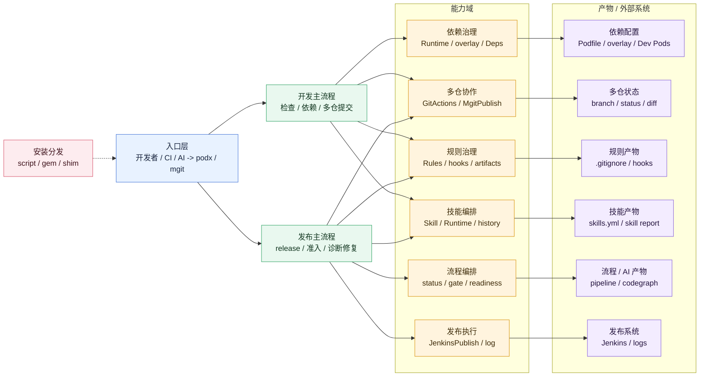

# cocoapods-podx

`cocoapods-podx` 是面向团队 iOS DevOps 的技能库与 skill runtime。它把依赖治理、多仓库 Git、发布触发、AI 辅助分析和团队规则沉淀为可执行、可校验、可复用的 `podx` / `mgit` 技能体系。

## 能力范围

- `podx`：团队 DevOps 技能入口，覆盖依赖安装、overlay 本地/远端切换、工程诊断、打开工程、发布触发和 AI 工程上下文。
- `podx skill`：团队技能运行时，沉淀依赖巡检、发布检查、失败诊断、半自动修复等高频流程。
- `mgit`：多仓库 Git 入口，覆盖 branch、status、diff、log、add、pull、push、commit、checkout、stash、publish。
- `podx ai`：生成 Claude Code 项目结构，接入 CodeGraph / Code Review Graph，沉淀 rules、skills、agents、commands、mcps。
- 安装脚本：安装、卸载、发布 gem，并生成 `podx` / `mgit` 命令。

Hermes Agent 与 iOS DevOps 的组合方案见 [HERMES_IOS_DEVOPS.md](HERMES_IOS_DEVOPS.md)。

## 整体架构



核心分层：

- 入口层：`podx`、`mgit` 和 MCP 是统一入口，分别承接依赖/发布意图、多仓库 Git 意图和 AI 调用意图。
- 主流程层：只保留开发主流程和发布主流程两条主线，避免把所有工具能力平铺给使用者。
- 能力域层：依赖治理、多仓库协作、发布执行、规则治理、技能编排、Pipeline Runtime 都是支撑主流程的能力域。
- 依赖治理能力域：`Runtime` 负责解析 `Podfile` 和 `podx.config.yml`；`本地源码切换` 是其中一个具体能力，由 `Podfile.overlay` 和 `Development Pods/` 共同完成；`Deps` 负责依赖版本和组件关系查看。
- 规则治理能力域：集中管理 `.gitignore` 本地产物治理、受保护文件、hooks、发布分支和发布渠道约束。
- 技能编排能力域：把依赖巡检、发布检查、失败诊断等高频动作沉淀为标准技能；`Skill Runtime` 只负责技能校验、演练、执行和历史记录，供开发/发布主流程调用。
- Pipeline Runtime 能力域：把开发/发布主流程、规则快照、技能门禁、发布策略、发布准入写成 `.podx/pipeline_*` 产物，供 CI 和发布前检查使用。
- 产物与外部系统：每个能力域都有对应产物或外部系统，例如依赖配置、多仓状态、规则产物、技能产物、流程/AI 产物和 Jenkins 发布日志。
- 安装分发层：`cocoapods-podx.sh` 负责 gem 安装、卸载、发布和 `podx/mgit` 命令 shim 生成。

## 依赖环境

基础环境：

- macOS：用于 iOS 工程、Xcode、CocoaPods 和 `open` 等系统能力。
- Ruby / RubyGems：用于运行 `cocoapods-podx` gem、构建 gem、安装命令 shim。
- CocoaPods：用于 `podx install`、`podx update`、`pod podx` 等 CocoaPods 插件能力。
- Git：用于 `mgit`、本地组件仓库、发布分支和远端 commit 信息查询。

发布和 CI 环境：

- Nexus RubyGems 仓库：存放 `cocoapods-podx-*.gem`，供团队安装和升级。
- Jenkins：供 `podx publish` 触发打包、查询历史、拉取日志、分析失败和执行维护 job。
- Hermes：可选，用于 Jenkins 失败日志二次分析和发布经验沉淀。
- Xcode / xcodebuild：仅 iOS 打包机或本地编译需要。

## 安装

在工程目录执行：

```bash
sh cocoapods-podx.sh install
```

指定版本：

```bash
sh cocoapods-podx.sh install 0.0.51
```

升级已安装插件：

```bash
podx upgrade
```

升级到指定版本：

```bash
podx upgrade 0.0.51
```

本地源码编译安装，不发布、不访问 Nexus：

```bash
sh cocoapods-podx.sh install-local
```

卸载：

```bash
sh cocoapods-podx.sh uninstall
```

验证：

```bash
podx version
podx help
mgit branch
```

安装脚本会优先安装到当前 CocoaPods 使用的 RubyGems 环境。没有 CocoaPods 的机器会进入 publish-only 模式，仍可使用 `podx publish --job ...`、`podx ai ...` 和 `mgit ...`。

## 主工程初始化

1. 在主 `Podfile` 中引入：

```ruby
require 'cocoapods-podx'
CocoapodsPodx::Runtime.configure(project_directory: __dir__)
source CocoapodsPodx::Runtime.private_source
```

2. 一键初始化主工程：

```bash
podx init
```

`podx init` 会先检查并升级到远端最新 `cocoapods-podx`，再完成工程配置、团队规则、技能库、流程产物、AI 上下文和 Git hooks 初始化。使用方只需要记住这一条命令；下面这些命令只在需要单独维护某个能力时使用：

```bash
podx sync
podx rules sync
podx skill init
podx pipeline script
podx ai init
podx hooks install
```

团队规则、skill、pipeline 或 AI 模板升级后，日常只需要通知大家执行 `podx sync`，不用分发一串子命令。`podx sync` 会先检查并升级到远端最新 `cocoapods-podx`，当前已是最新版本时会自动跳过升级，再同步团队基线。

3. 验证结果：

```bash
podx doctor
podx deps
podx pipeline status
mgit status
```

`podx.config.yml` 只保存工程级配置，例如 specs 源、Git 根地址、发布工作目录和多仓库发布列表。`.podx/skills.yml`、`.podx/pipeline_ci.sh` 属于团队约定，建议提交到 Git；`podx init` / `podx sync` 会按最新模板补齐或更新它们。`.podx/skill_runs.yml`、`.podx/*_snapshot.*`、`.podx/*_report.*` 等运行产物和本地目录会由规则器补齐到 `.gitignore`，避免不同设备提交冲突。

需要在 CI 中校验规则、技能和流程时再执行：

```bash
podx rules ci
podx skill ci strict
podx pipeline snapshot
podx pipeline report
podx pipeline gate
```

## 常用命令

高阶意图命令适合日常使用，底层仍复用已有 `podx` / `mgit` 能力：

```bash
podx workon NNBussCom            # 开始开发组件，等同 podx NNBussCom
podx dev NNBussCom               # 同 podx workon
podx check                       # 检查工程接入和本地组件状态，等同 podx doctor
podx health                      # 同 podx check
podx graph                       # 更新 AI 图谱并检查改动影响，等同 podx ai update
podx tools                       # 检查 rg/fd/bat/jq/yq/delta/ast-grep/ctags/htop 等现代 CLI
podx ship tf --branch release/5.14.2
                                  # 发布意图入口，等同 podx publish tf --branch release/5.14.2
podx ship dry-run app --branch release/5.14.2
                                  # 预览发布参数，等同 podx dry-run publish app
podx diagnose 1274               # 分析 Jenkins 打包失败，等同 podx publish doctor 1274
podx repair 1274                 # 半自动修复 Jenkins 打包失败，等同 podx publish fix 1274
```

```bash
podx install --no-repo-update    # 执行 pod install，并处理 overlay 本地依赖
podx update NNBussCom            # 更新指定 pod；命中 overlay 本地组件时先更新本地仓库
podx NNBussCom                   # 切到本地源码
podx disable NNBussCom           # 切回远端
podx disable                     # 全部切回远端
podx doctor                      # 检查工程配置和本地组件状态
podx rules                       # 查看当前工程规则器规则
podx rules check                 # 检查 .gitignore 是否符合规则器治理
podx rules sync                  # 补齐 .gitignore 中缺失的本地产物规则
podx rules snapshot              # 生成 .podx/rules_snapshot.json 规则快照
podx rules ci                    # CI 门禁：生成规则快照，失败时返回非 0
podx pipeline                    # 查看团队 CI/CD 能力地图
podx pipeline flow               # 查看开发/发布主流程
podx pipeline ci                 # 查看团队 CI 门禁模板
podx pipeline script             # 生成 .podx/pipeline_ci.sh，内置快照/报告/总门禁
podx pipeline doctor             # 检查团队 CI 脚本是否存在、可执行且与模板一致
podx pipeline snapshot           # 生成 .podx/pipeline_snapshot.json
podx pipeline report             # 生成 .podx/pipeline_report.md
podx pipeline status             # 汇总 rules/skill/pipeline 产物状态
podx pipeline gate               # CI 总门禁：汇总产物状态，失败时返回非 0
podx pipeline policy             # 查看发布渠道门禁策略
podx pipeline readiness          # 按当前门禁和策略评估各渠道发布准入
podx open                        # 打开 .xcworkspace
podx open --overlay              # 打开或生成 Podfile.overlay
podx upgrade                     # 升级 cocoapods-podx 到 Nexus 最新版本
podx upgrade 0.0.51              # 升级 cocoapods-podx 到指定版本
podx hooks install               # 安装版本化 Git 提交保护 hook，默认拦截 Podfile
podx publish                     # 触发默认发布渠道
podx publish tf                  # 触发 TestFlight 发布
podx publish app                 # 触发 App Store 发布
podx publish --pipeline-gate     # 发布前执行 pipeline 总门禁
podx publish --no-pipeline-gate  # 临时跳过发布前 pipeline 总门禁
podx publish --job JOB_NAME      # 指定发布任务
podx publish history             # 表格查看默认 job 最近 10 次构建
podx publish history 20 --job JOB_NAME
                                  # 表格查看指定 job 最近 20 次构建
podx publish log                 # 查看默认 job 最近一次 Jenkins 构建日志
podx publish log 1274 --lines 80 # 查看指定构建号最后 80 行日志
podx publish log --job JOB_NAME  # 查看指定 job 最近一次 Jenkins 构建日志
podx publish doctor              # 分析默认 job 最近一次 Jenkins 打包失败原因
podx publish doctor 1274         # 分析指定构建号的失败原因
podx publish doctor --no-hermes  # 只使用本地规则分析，不调用 Hermes
podx publish fix 1274            # 半自动修复低风险失败；执行前确认
podx publish fix 1274 --dry-run  # 只查看修复动作，不执行
podx publish fix 1274 --fix-job podx-upgrade
                                  # 触发 Jenkins 维护 job 升级打包机插件
podx dry-run publish app         # 预览发布参数
```

`publish_pipeline_gate: true` 开启发布前预检后，默认策略为：蒲公英 `warn`，TestFlight/AppStore `strict`，Framework `warn`。可通过 `publish_pipeline_gate_strategy` 覆盖。

```bash
podx skill list                  # 查看团队 DevOps 技能库
podx skill list 发布             # 按关键词筛选技能库
podx skill init                  # 初始化项目级 .podx/skills.yml
podx skill show dependency_audit # 查看技能定义和执行步骤
podx skill doctor                # 体检团队 DevOps 技能库可用性
podx skill graph                 # 查看技能依赖关系
podx skill plan local_release_readiness
                                  # 展开技能执行计划，不执行任务
podx skill lint                  # 检查技能库定义规范，适合 CI 或提交前检查
podx skill verify release_testflight
                                  # 校验技能执行前置条件
podx dry-run skill run dependency_audit
                                  # 演练技能，不写入运行历史
podx skill run dependency_audit  # 执行技能
podx skill history 10            # 查看最近 10 次技能运行记录
podx skill stats                 # 查看技能运行统计和成功率
podx skill report                # 查看技能库治理总览，适合日报或 CI 摘要
podx skill suggest               # 根据治理状态给出下一步建议
podx skill snapshot              # 生成 .podx/skill_snapshot.md 治理快照
podx skill ci                    # CI 校验技能库并生成 Markdown/JSON 治理报告
podx skill ci strict             # 严格 CI 门禁，report fail 也会失败
```

项目级 `.podx/skills.yml` 支持通过 `depends_on` 组合已有技能，适合把依赖巡检、发布前状态检查、失败诊断等基础动作编排成团队高阶流程。

```bash
mgit branch                      # 查看主工程和本地组件分支
mgit status                      # 查看多仓库状态
mgit diff                        # 查看多仓库 diff
mgit log                         # 查看多仓库最近提交
mgit pull                        # 多仓库拉取
mgit push                        # 多仓库推送
mgit add                         # 多仓库 git add -A
mgit commit -m "message"         # 多仓库提交
mgit commit -m "message" -edit Podfile # 显式允许提交受保护文件
mgit checkout NNBussCom develop  # 切换指定组件分支
mgit stash NNBussCom             # stash 指定组件仓库
mgit publish release/x.y.z       # 创建或更新多仓库发布分支
```

`podx hooks install` 会展示当前工程规则，并在主工程生成可提交的 `.githooks/pre-commit` 和 `.githooks/post-merge`，同时设置本地 Git 配置 `core.hooksPath=.githooks`。默认只保护主工程的 `Podfile`；如需调整保护文件，可在 `podx.config.yml` 中配置：

```yaml
protected_commit_files:
  - Podfile
```

受保护文件只能由 `mgit publish <branch>` 或 `mgit commit -m "msg" -edit Podfile` 提交；普通 `git commit`、未声明 `-edit` 的 `mgit commit` 和其他入口都会被 hook 拦截。`.githooks/` 可加入 Git 记录，规则内容能随仓库同步；新电脑仍需执行一次 `podx init` 或 `podx hooks install`，用于写入本地 `core.hooksPath`。

`git pull`、`mgit pull` 或 `git merge` 后如果受保护文件被带入变更，`post-merge` 会从 `ORIG_HEAD` 自动还原该文件并输出提示。

规则清单会同时展示 `mgit publish release/x.y.z` 相关约束：发布分支、Podfile 组件分支改写、iOS 主工程 Version/Build 生成规则，以及 `podx publish tf/app` 的 release 分支限制。执行 `podx publish tf` 或 `podx publish app` 时，如果未指定 `--branch`，当前主工程分支也必须是 `release/x.x.x`；发布前还会确认主工程和依赖组件的远端 `release/x.x.x` 分支都存在。

## 常见用法

已有主工程初始化：

```bash
podx init
podx doctor
```

新电脑安装并验证：

```bash
sh cocoapods-podx.sh install
podx version
podx doctor
```

切换组件到本地源码开发：

```bash
podx workon NNBussCom
podx install
podx open
```

查看当前工程依赖和多仓库状态：

```bash
podx deps
mgit branch
mgit status
```

同步主工程和本地组件：

```bash
mgit pull
podx install
```

提交本地组件变更：

```bash
mgit status
mgit add .
mgit commit -m "update: 描述变更"
mgit push
```

发布蒲公英测试包：

```bash
podx pipeline readiness
podx publish
```

发布 TestFlight 或 App Store：

```bash
mgit publish release/x.y.z
podx publish tf --branch release/x.y.z
podx publish app --branch release/x.y.z
```

查看和诊断 Jenkins 构建：

```bash
podx publish history 10
podx publish log BUILD
podx publish doctor BUILD
podx publish fix BUILD --dry-run
```

生成团队 CI/CD 产物：

```bash
podx rules ci
podx skill ci strict
podx pipeline snapshot
podx pipeline report
podx pipeline gate
```
