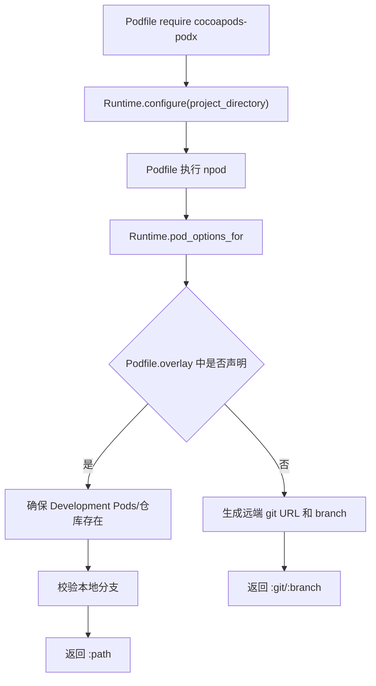
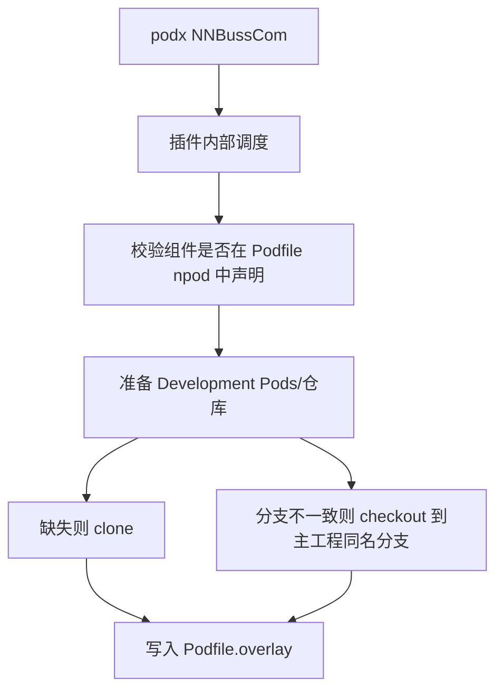
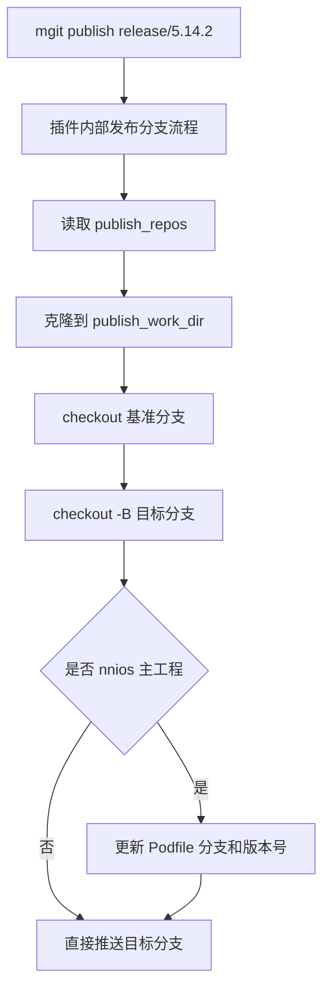

# cocoapods-podx 架构说明

`cocoapods-podx` 是一个 CocoaPods 插件，核心目标是在不频繁修改主工程 `Podfile` 的前提下，管理内部组件的本地源码调试、远端依赖切换、多仓库 git 操作和发布流程。

如果只想快速了解整体架构图和能力边界，先看 [CAPABILITY_MAP.md](CAPABILITY_MAP.md)。

当前插件已经从单一命令脚本演进为三层结构：

1. 命令入口层：`podx`、`mgit`
2. Runtime 层：`npod` DSL、配置读取、依赖解析、本地/远端切换
3. 功能模块层：overlay 文件、组合 git、Jenkins 发布、多仓库发布分支、命令 shim

## 目录结构

```text
nn-ios-tools/cocoapods-podx/
  bin/
    podx                                      # pod 增强命令入口
    mgit                                      # 多仓库 git 命令入口
  lib/
    cocoapods-podx.rb                     # 插件加载入口，注入 npod DSL
    cocoapods_plugin.rb                      # CocoaPods 插件发现入口
    pod/command/podx.rb                      # Pod::Command::Podx 命令发现入口与调度实现
    cocoapods_podx/
      runtime.rb                             # Podfile runtime、npod 解析、本地/远端依赖决策
      shim_generator.rb                      # podx/mgit shim 模板读取
      publish_only.rb                        # 无 CocoaPods 环境下的 podx publish-only 入口
      mgit_standalone.rb                     # 无 CocoaPods 环境下的 mgit 入口
      commands/
        overlay_file.rb                      # Podfile.overlay 读写和格式化
        git_actions.rb                       # mgit checkout/stash/status/diff/log/add/pull/push/commit
        mgit_publish.rb                      # mgit publish 多仓库发布分支
        jenkins_publish.rb                   # podx publish Jenkins 打包发布
  test/test_runtime.rb                       # 轻量单元测试
```

插件目录只保留 gem 源码、命令模板和测试。安装、卸载、发布脚本放在主工程 `tools/` 目录：

```text
tools/cocoapods-podx.sh                   # 安装、卸载、发布统一入口
tools/install-cocoapods-podx.sh           # 从 Nexus 安装或升级插件的底层脚本
tools/uninstall-cocoapods-podx.sh         # 卸载插件和命令 shim 的底层脚本
tools/publish-cocoapods-podx.sh           # 维护者发布 gem 到 Nexus 的底层脚本
```

## 命令入口

### 插件内部调度

内部调度类定义在：

```text
lib/pod/command/podx.rb
```

它负责：

- 解析 CocoaPods/CLAide 参数
- 找到主工程目录和 `Podfile`
- 初始化 `CocoapodsPodx::Runtime`
- 按模式分发到不同模块
- 安装命令 shim

`podx.rb` 内部主类为 `Pod::Command::Podx`，应保持为“调度器”，不要继续堆业务流程。新增大功能时优先放到 `lib/cocoapods_podx/commands/` 下的模块。

### podx

`podx` 是给日常使用者的增强入口，定义在：

```text
bin/podx
```

它把用户友好的命令转换为插件内部动作或原生 `pod`：

```text
podx NNBussCom        -> 切换 NNBussCom 到本地源码
podx update NNBussCom -> 更新本地仓库并执行 pod update NNBussCom
podx publish tf       -> 触发 TestFlight 发布
podx install          -> pod install
```

设计原则：

- `podx` 新增命令优先执行插件语义
- 与原生 `pod` 无冲突的命令直接透传
- 与原生 `pod` 有冲突时，需要原生语义就直接使用 `pod`

### mgit

`mgit` 是多仓库 git 入口，定义在：

```text
bin/mgit
```

它把组合 git 命令转换为插件内部动作：

```text
mgit status                 -> 组合查看多仓库状态
mgit checkout release/x.x.x -> 组合切换本地组件仓库分支
mgit stash                  -> 组合暂存多仓库未提交修改
mgit diff                   -> 组合查看多仓库 diff
mgit commit -m "msg"        -> 组合提交多仓库
mgit publish release/5.14.2 -> 创建或更新多仓库发布分支
```

`mgit` 只承载多仓库 git 语义，不承载 CocoaPods 依赖安装语义。
`bin/mgit` 始终直接进入 `cocoapods_podx/mgit_standalone`，不再通过 `pod podx` 转发，避免不同机器的 CocoaPods / RubyGems 环境影响 `mgit`。
当前支持 branch、checkout、merge、stash、status、diff、log、add、pull、push、commit、publish。

## Runtime 层

Runtime 定义在：

```text
lib/cocoapods_podx/runtime.rb
```

它是插件的核心执行上下文，负责以下事情：

- 读取 `podx.config.yml`
- 解析主 `Podfile` 中的 `npod`
- 注入 `npod` 到 CocoaPods DSL
- 判断组件走本地还是远端
- 生成本地 `:path` 或远端 `:git/:branch` pod options
- 校验本地组件分支
- 缺失本地仓库时自动 clone 到 `Development Pods/`

### npod

插件在 `cocoapods-podx.rb` 中通过 `Pod::Podfile::DSL.prepend` 注入 `npod`：

```ruby
pod 'NNLibrary', :branch => 'develop', :remote_name => 'NNYYText', :local_name => 'NNLibrary'
```

带内部组件参数的 `pod` 声明表示：这是一个由 overlay 管理的内部组件。

内部组件 `pod` 不直接等于本地源码。是否本地源码由 `Podfile.overlay` 决定：

- `Podfile.overlay` 中出现该组件：走本地 `Development Pods/`
- 未出现：走远端 git 仓库

### podx.config.yml

配置文件放在主工程 `Podfile` 同级目录，描述工程级差异：

```yaml
target_name: nn_ios
private_source: SPECS_REPO_URL
git_base_url: GIT_BASE_URL
publish_work_dir: .mgit-publish
publish_base_branch: develop
publish_main_repo: nnios
publish_update_podfile_branch: true
publish_repos:
  - nnios
  - nnbusscom
publish_version:
  type: ios_xcodeproj
  branch_pattern: '^release/(\d+\.\d+\.\d+)$'
  project_file: NNIM.xcodeproj/project.pbxproj
  build_number_strategy: ios_semver
```

配置文件不维护“哪些组件可 overlay”。组件范围来自主 `Podfile` 的内部组件 `pod` 声明，这样分支、仓库名、group 关系都在依赖声明处就近管理。

插件会优先读取 `podx.config.yml`，旧工程中的 `Podfile.overlay.config.yml` 仍会作为兼容 fallback 读取；新工程建议只保留 `podx.config.yml`。

`mgit publish` 的通用内核只负责多仓库分支发布。`publish_main_repo`、`publish_update_podfile_branch`、`publish_version` 属于工程定制动作，未显式配置时不会修改 `Podfile` 或 iOS 工程版本号。

## 功能模块

### OverlayFile

文件：

```text
lib/cocoapods_podx/commands/overlay_file.rb
```

职责：

- 读取 `Podfile.overlay`
- 写入 `Podfile.overlay`
- 生成默认模板
- 去掉组件列表之间多余空行
- 兼容旧写法 `pod 'XXX'`

该模块只处理 overlay 文件格式，不处理 git、pod install 或仓库下载。

### GitActions

文件：

```text
lib/cocoapods_podx/commands/git_actions.rb
```

职责：

- `mgit status`
- `mgit checkout`
- `mgit stash`
- `mgit diff`
- `mgit log`
- `mgit add`
- `mgit pull`
- `mgit push`
- `mgit commit -m "msg"`

仓库范围来自：

- 主工程 `main`
- 当前 `Podfile.overlay` 中切到本地的组件仓库
- 用户显式指定的组件名

该模块不会自动切换本地/远端依赖，只做组合 git 操作。

### MgitPublish

文件：

```text
lib/cocoapods_podx/commands/mgit_publish.rb
```

职责：

- `mgit publish release/x.x.x`
- 按配置克隆多个远端仓库到临时目录
- 从基准分支创建或更新发布分支
- 处理主工程 `Podfile` 中的分支同步
- 根据 `release/x.x.x` 更新主工程版本号和 build 号
- 按 push mode 推送远端分支

版本号规则：

```text
release/5.14.2  -> MARKETING_VERSION 5.14.2  -> CURRENT_PROJECT_VERSION 501402
release/5.14.10 -> MARKETING_VERSION 5.14.10 -> CURRENT_PROJECT_VERSION 501410
```

仓库列表不写死在模块内，优先来自 `podx.config.yml` 的 `publish_repos`。

### JenkinsPublish

文件：

```text
lib/cocoapods_podx/commands/jenkins_publish.rb
```

职责：

- `podx publish`
- `podx publish tf`
- `podx publish app`
- 选择可用 Jenkins 地址
- 读取 Jenkins job 参数配置，按 job 能力决定发布类型
- 查询远端仓库当前分支 commit
- 输出打包仓库表格
- 触发 Jenkins build
- 轮询队列、构建进度和结果；交互式终端中构建进度单行刷新
- 打印失败原因；Jenkins `ABORTED` 结果会提示打包任务已取消

发布服务地址由配置或环境变量提供，不在架构文档中记录具体内网地址。

发布任务支持的渠道和参数由任务配置决定。工具优先读取发布任务参数定义，读取失败时按配置兜底判断。

后续如果要做通用化，建议把 Jenkins 默认地址、job 能力兜底规则、仓库表格列表也移到配置文件。

### ShimGenerator

文件：

```text
lib/cocoapods_podx/shim_generator.rb
```

职责：

- 读取 `bin/podx`
- 读取 `bin/mgit`
- 给安装脚本统一生成快捷命令

这样 `podx`、`mgit` 的模板只维护一份，不会在 `Pod::Command::Podx`、安装脚本中重复。

## 关键流程

### pod install 时依赖解析



### podx 切本地



### mgit publish



## 安装与发布

### 本地安装

```text
tools/cocoapods-podx.sh install
```

职责：

- 从 Nexus 下载指定版本或最新版本 gem
- 安装到当前 `pod` 命令对应的 CocoaPods gem 环境
- 重新生成 `podx`、`mgit`
- 清理旧的 `pox`

如果当前机器没有 `pod` 命令，安装脚本进入 publish-only 模式：

- gem 安装到当前用户 RubyGems 环境
- `podx` 写入 `~/.local/bin` 或 `COCOAPODS_PODX_BIN_DIR`
- `mgit` 写入 `~/.local/bin` 或 `COCOAPODS_PODX_BIN_DIR`
- 支持 `podx publish --job ...`
- 支持 `podx ai ...`
- 支持全部 `mgit` 多仓库 git 命令

### Nexus 发布

```text
tools/cocoapods-podx.sh publish
```

职责：

- 校验发布密码
- 更新 gemspec 版本
- 本地构建 gem
- 上传到 Nexus raw 仓库

Nexus 删除旧包是运维动作，不放进插件项目代码。需要清理旧版本时，用一次性脚本或 Nexus 管理后台处理。

## 扩展原则

### 新增 podx 命令

1. 优先判断是否和原生 `pod` 命令冲突。
2. 如果是插件增强能力，在 `bin/podx` 中映射到插件内部动作。
3. 如果逻辑超过少量分发代码，在 `lib/cocoapods_podx/commands/` 下新增模块。
4. `Pod::Command::Podx` 只加参数解析和分发。

### 新增 mgit 命令

1. 在 `bin/mgit` 中映射参数。
2. 普通组合 git 动作放到 `GitActions`。
3. 发布分支类动作放到 `MgitPublish` 或新模块。
4. 避免支持破坏性命令，例如 `reset --hard`，除非有明确保护和二次确认。

### 新增工程差异配置

优先放入 `podx.config.yml`，不要写死在插件内核。

适合配置化的内容：

- Jenkins 地址
- 发布仓库列表
- 发布分支基准
- 版本号解析规则
- 主工程版本文件路径
- 公司内部服务地址

不适合配置化的内容：

- 当前 `Podfile.overlay` 中哪些组件走本地，这个应由 `Podfile.overlay` 表达
- 单个 pod 的分支、group、remote/local 名称，这个应由主 `Podfile` 的 `npod` 就近表达

## 测试策略

当前轻量测试集中在：

```text
test/test_runtime.rb
```

已覆盖：

- `npod` 管理组件解析
- `Podfile.overlay` 本地/远端切换
- 缺失本地仓库自动 clone
- `publish_repos` 配置读取
- `mgit publish` build 号规则
- `podx/mgit` shim 模板读取
- overlay 文件空行格式化
- git action 辅助逻辑
- Jenkins 表格/进度辅助格式

建议后续补充：

- `bin/podx` 参数映射测试
- `bin/mgit` 参数映射测试
- `mgit publish --push-mode skip` 的 fixture 测试
- Jenkins HTTP 行为使用 fake server 测试

## 当前边界和注意事项

- 插件核心已经具备通用性，但当前默认配置和文档仍服务于 NN iOS 工程。
- `JenkinsPublish` 仍包含 NN 当前 Jenkins 默认地址，后续可配置化。
- `podx update NNBussCom` 会先更新 overlay 本地仓库，再执行原生 `pod update NNBussCom`。
- `Podfile.overlay` 不纳入 git，`podx.config.yml` 建议纳入 git。
- `Development Pods/` 不纳入 git，只存放本地主工程内的组件源码。
- Nexus 旧 gem 清理是发布仓库维护动作，不属于插件运行时能力。
