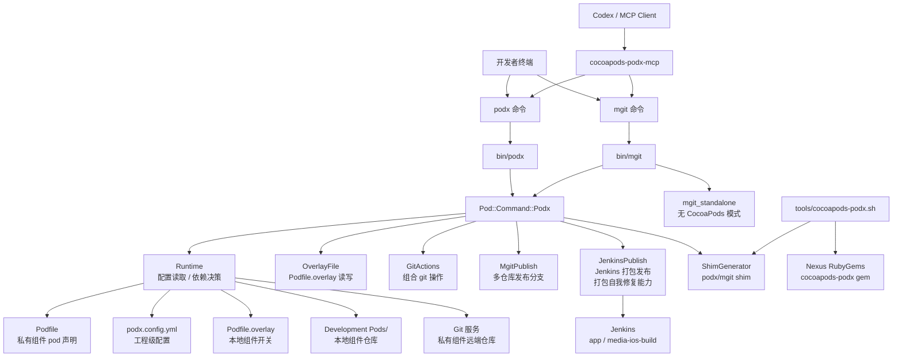
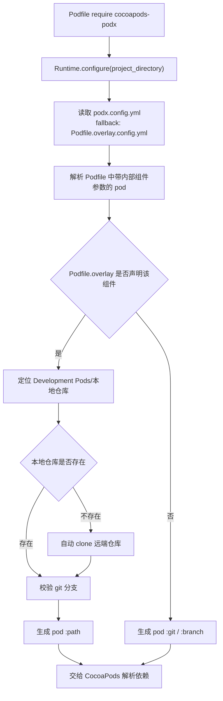
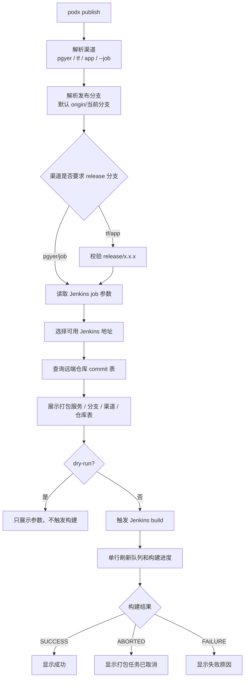
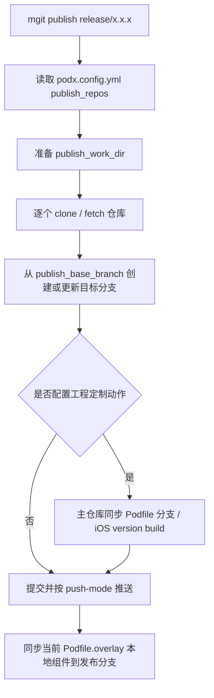

# cocoapods-podx 整体架构图与能力集

`cocoapods-podx` 当前已经不是单一的 CocoaPods overlay 插件，而是一套围绕需求分析、开发影响分析、私有组件开发、测试验证、组合 git 操作、Jenkins 发布和 AI/MCP 演进的工程指令服务。

它的边界可以概括为：

- `podx`：负责 CocoaPods 增强能力、overlay 本地/远端切换、Jenkins 发布。
- `mgit`：负责多仓库 git 操作和多仓库发布分支。
- `cocoapods-podx-mcp`：把常用 `podx` / `mgit` 能力暴露给 Codex。
- `.claude/`：沉淀团队统一的 Claude rules、skills、agents、commands、mcps。
- `tools/cocoapods-podx.sh`：负责插件安装、卸载、发布到 Nexus。

Hermes Agent 与 iOS DevOps 的组合方案见 [HERMES_IOS_DEVOPS.md](HERMES_IOS_DEVOPS.md)。

## 整体架构



## 分层说明

| 层级 | 主要文件 | 职责 |
| --- | --- | --- |
| 命令入口层 | `bin/podx`、`bin/mgit` | 把用户命令映射为插件动作或原生 `pod` / `git` 语义 |
| CocoaPods 插件层 | `lib/pod/command/podx.rb` | 统一调度 `podx`、`mgit`、publish、doctor、shim 等能力 |
| Runtime 层 | `lib/cocoapods_podx/runtime.rb` | 读取配置，解析内部组件，决定本地 `:path` 或远端 `:git/:branch` |
| 功能模块层 | `commands/*.rb` | 拆分 overlay 文件、组合 git、Jenkins 发布、多仓库发布分支 |
| 安装发布层 | `tools/cocoapods-podx.sh`、`install/uninstall/publish` 脚本 | 从 Nexus 安装、升级、卸载、发布 gem，生成命令 shim |
| AI 集成层 | `podx-tools/cocoapods-podx-mcp/server.js` | 给 Codex 暴露受控的 `podx` / `mgit` 工具；不需要放在主工程目录下 |

## 能力集

| 能力分类 | 命令 | 说明 |
| --- | --- | --- |
| 官方 pod 命令 | `podx install`、`podx repo update`、`podx update AppFeatureKit` | 保持 CocoaPods 原生命令语义；`podx update` 会在命中本地 overlay 组件时先更新本地仓库 |
| 工程初始化 | `podx init` | 先升级到远端最新插件，再一键初始化工程配置、团队规则、技能库、流程产物、AI 上下文和 Git hooks |
| 团队基线同步 | `podx sync` | 先升级到远端最新插件，再把团队规则、skill、pipeline 和 AI 模板同步到当前工程 |
| 本地/远端切换 | `podx AppFeatureKit`、`podx disable AppFeatureKit`、`podx disable` | 管理 `Podfile.overlay`，决定私有组件走本地源码还是远端仓库 |
| Overlay 查询 | `podx`、`podx main`、`podx list`、`podx doctor`、`podx open --overlay` | 查看支持组件、主 Podfile 配置、本地/远端状态、健康检查和打开 overlay 文件 |
| 打开工程 | `podx open` | 打开当前工程 `.xcworkspace` |
| Jenkins 发布 | `podx publish`、`podx publish tf`、`podx publish app`、`podx publish --job media-ios-build` | 触发 Jenkins job；默认发布远端当前分支，不发布本地未提交代码 |
| 多仓库 git | `mgit branch/status/diff/log/add/pull/push/commit/checkout/stash` | 对主工程和 overlay 本地组件执行组合 git 操作 |
| 多仓库发布分支 | `mgit publish release/5.14.2`、`mgit dry-run publish release/5.14.2` | 从基准分支创建或更新多个仓库的发布分支，并按配置执行工程定制动作 |
| 无 CocoaPods 模式 | `podx publish --job ...`、`podx ai ...`、全部 `mgit` 命令 | 新机器没有 CocoaPods 时仍可安装到用户 RubyGems 环境，用于 Jenkins 发布、AI 初始化和多仓库 git |
| MCP 能力 | `podx_doctor`、`podx_main`、`podx_install`、`podx_update`、`mgit_status`、`mgit_branch`、`mgit_diff`、`mgit_pull`、`mgit_checkout`、`mgit_stash` | 供 Codex 通过 MCP 安全调用常用维护命令 |
| AI 辅助初始化 | `podx ai init/update/doctor/memory/mcp` | 生成 Claude Code 的 `commands/rules/skills/agents/memory/mcps` 项目结构，以及 CodeGraph / Code Review Graph 脚本、Hermes MCP 注册脚本和记忆规范 |
| 插件运维 | `sh tools/cocoapods-podx.sh install/uninstall/publish` | 安装、卸载、发布 `cocoapods-podx` gem |

## podx 与 mgit 边界

| 入口 | 适合做什么 | 不做什么 |
| --- | --- | --- |
| `podx` | CocoaPods 安装更新、本地/远端切换、Jenkins 打包发布、打开工程 | 不做组合 git commit/push，不创建多仓库发布分支 |
| `mgit` | 多仓库 git 操作、多仓库发布分支 | 不做 pod install，不改变 CocoaPods 解析逻辑 |
| `pod` | 原生 CocoaPods 命令 | 不承担 podx 扩展语义 |

## Pod 依赖决策流程



## Jenkins 发布流程



## mgit publish 流程



## 关键文件

| 文件或目录 | 是否建议提交 | 作用 |
| --- | --- | --- |
| `Podfile` | 是 | 声明官方 pod 和内部组件 pod；内部组件分支、group、remote/local 名在这里就近管理 |
| `podx.config.yml` | 是 | 工程级配置，例如私有源、git 根地址、Jenkins/mgit publish 所需仓库列表 |
| `Podfile.overlay` | 否 | 个人本地开关，只声明哪些组件走本地源码 |
| `Development Pods/` | 否 | 本地组件仓库目录，不依赖主工程外部路径 |
| `.mgit-publish/` | 否 | `mgit publish` 临时工作目录 |
| `podx-tools/cocoapods-podx/` | 是 | 插件源码、命令模板、测试；不需要放在主工程目录下 |
| `podx-tools/cocoapods-podx-mcp/` | 是 | Codex MCP server；不需要放在主工程目录下 |

## 典型使用链路

### 本地调试内部组件

```bash
podx AppFeatureKit
podx install
mgit branch AppFeatureKit
```

### 更新本地组件并刷新 Pods

```bash
podx update AppFeatureKit
```

### 多仓库提交

```bash
mgit status
mgit diff
mgit add AppFeatureKit AppBaseKit
mgit commit AppFeatureKit AppBaseKit -m "feat: update components"
mgit push AppFeatureKit AppBaseKit
```

### Jenkins 发布

```bash
podx publish
podx publish tf --branch release/5.14.2
podx publish --job media-ios-build --branch develop
```

### 多仓库发布分支

```bash
mgit dry-run publish release/5.14.2
mgit publish release/5.14.2
```

### 新机器安装

```bash
sh tools/cocoapods-podx.sh install
podx version
podx doctor
```

没有 CocoaPods、只需要 Jenkins 发布或 `mgit` 时：

```bash
sh tools/install-cocoapods-podx.sh
podx publish --job media-ios-build --branch develop
mgit status
```

## 设计约束

1. 通用内核不能写死具体业务规则。工程差异应放在 `podx.config.yml` 或 `Podfile` 的组件声明中。
2. `Podfile.overlay` 只表达“哪些组件本地化”，不表达分支、远端地址或 group 关系。
3. `podx publish` 只发布远端分支 HEAD，不发布本地未提交代码。
4. `mgit publish` 默认只做多仓库分支管理；修改 iOS 版本号、build 号、Podfile 分支属于显式配置后的工程定制动作。
5. 无 CocoaPods 模式只保证 `podx publish --job ...`、`podx ai ...` 和 `mgit` 可用，不保证 pod install/update 类能力。
6. `podx.config.yml` 是新配置入口；旧 `Podfile.overlay.config.yml` 只作为兼容 fallback。
