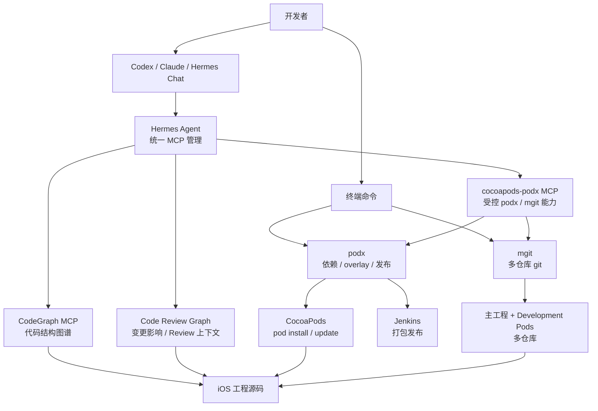

# Hermes Agent 与 iOS DevOps

这份文档描述如何把 Hermes Agent 接入 iOS 工程协作流程，用统一的 AI/MCP 运行时优化需求分析、开发、测试、依赖治理、多仓库协作和发布。

Hermes 不替代 `podx` / `mgit` / Jenkins。它负责把 AI 工具、MCP 服务、知识图谱和工程命令组织成稳定入口；`podx` 和 `mgit` 继续负责工程动作本身。

## 目标

- 统一团队 AI/MCP 接入方式，避免每个人分别维护 Codex、Claude、MCP 配置。
- 固化 iOS 工程开发规则、发布规则、组件依赖规则和代码审查规则。
- 让 AI 先读图谱、再分析影响、再执行受控命令，减少盲改代码。
- 把多仓库状态、组件分支、发布分支、Jenkins 打包结果纳入同一套工程指令。
- 用 Hermes 记忆沉淀稳定团队偏好和反复出现的问题处理经验。
- 普通 iOS 编译和 CocoaPods 流程不依赖 Hermes；只有 AI/MCP 能力需要 Hermes。

## 分层架构



## 职责边界

| 模块 | 职责 | 不负责 |
| --- | --- | --- |
| Hermes | 管理 MCP、统一 AI 工具入口、执行工程级 AI 指令 | 不直接修改 Podfile 依赖决策，不替代 CI |
| CodeGraph | 快速检索符号、文件、调用关系和影响半径 | 不保证编译正确性 |
| Code Review Graph | 变更检测、影响面、Review 上下文 | 不替代人工评审结论 |
| podx | CocoaPods 增强、overlay、本地/远端组件、Jenkins 发布、AI 初始化 | 不做多仓库 git commit/push |
| mgit | 多仓库 branch/status/diff/log/add/pull/push/commit/checkout/stash/publish | 不做 pod install，不触发 Jenkins |
| Jenkins | 构建、签名、分发、TestFlight/App Store 发布 | 不决定本地开发组件状态 |

## 团队接入

AI/MCP 使用者执行：

```bash
sh .claude/mcps/setup-hermes-mcp.sh
```

脚本会：

- 检查 Hermes 是否存在。
- 缺少 Hermes 时自动安装。
- 注册当前工程 MCP。
- 测试 CodeGraph MCP。

如果团队有内部 Hermes 安装镜像：

```bash
HERMES_INSTALL_URL="内部安装脚本地址" sh .claude/mcps/setup-hermes-mcp.sh
```

如果 Hermes 已经安装在固定路径：

```bash
HERMES_BIN=/path/to/hermes sh .claude/mcps/setup-hermes-mcp.sh
```

普通 Xcode 编译、`podx install`、`podx update`、`mgit status` 不要求安装 Hermes。

## Hermes 记忆

Hermes 内置记忆始终可用，默认保存在开发者本机 Hermes home 中。工程仓库只提交 `.claude/memory/` 下的记忆规范和模板，不提交个人记忆内容。

常用命令：

```bash
podx ai memory
hermes memory status
hermes memory setup
```

适合写入记忆：

- 稳定团队规范和个人协作偏好。
- 反复出现的依赖、构建、发布问题处理经验。
- CodeGraph、Code Review Graph、podx、mgit 的团队使用约定。
- 需求分析、测试验证、发布检查中的长期规则。

禁止写入记忆：

- 密码、token、证书、私钥和 provisioning 凭据。
- 内部服务地址、账号信息和发布平台密钥。
- 临时日志、一次性失败输出、未经确认的猜测。
- 与开发协作无关的个人信息。

外部记忆 provider 是可选能力，可由个人按需执行 `hermes memory setup` 配置；团队基础流程只依赖内置记忆即可。

## DevOps 闭环

### 1. 需求阶段

输入需求后，AI 应先做工程上下文读取：

```bash
podx ai update
```

推荐流程：

- 用 CodeGraph 查入口、模块、调用关系。
- 用 Code Review Graph 看近期变更和高风险区域。
- 输出影响模块、涉及组件、预估测试范围。

产出：

- 需求拆解。
- 影响范围。
- 组件列表。
- 风险点和验证建议。

### 2. 开发阶段

组件源码调试：

```bash
podx AppFeatureKit
podx install
```

更新组件：

```bash
podx update AppFeatureKit
```

多仓库状态：

```bash
mgit status
mgit diff
mgit branch
```

AI 应优先通过图谱理解代码，再执行受控命令；涉及多仓库变更时，用 `mgit status/diff` 汇总上下文。

### 3. 测试阶段

推荐让 AI 输出测试清单：

- 受影响模块。
- 受影响页面或业务流程。
- 需要验证的组件组合。
- 是否需要真机、弱网、升级、回归测试。

工程命令：

```bash
podx doctor
podx ai doctor
```

如后续接入 XcodeBuild MCP，可把构建、测试、日志和截图也纳入 Hermes 管理。

### 4. 发布阶段

预览发布参数：

```bash
podx dry-run publish
podx dry-run publish tf --branch release/x.y.z
```

触发发布：

```bash
podx publish
podx publish tf --branch release/x.y.z
podx publish app --branch release/x.y.z
```

多仓库发布分支：

```bash
mgit dry-run publish release/x.y.z
mgit publish release/x.y.z
```

发布前检查：

- 当前发布分支是否正确。
- 远端 commit 是否符合预期。
- 本地是否还有未提交变更。
- Podfile 中组件分支是否已同步。
- Jenkins 参数是否满足渠道要求。

发布后记录：

- 发布渠道。
- 分支。
- 远端 commit 表。
- Jenkins build 编号。
- 成功或失败原因。

## 推荐团队规范

1. AI/MCP 接入统一使用 Hermes，不再手工维护多份 MCP 配置。
2. `podx publish` 只发布远端分支 HEAD，不发布本地未提交代码。
3. `Podfile.overlay` 是个人本地配置，不提交。
4. `Development Pods/` 是本地组件仓库，不提交。
5. 需求和改动分析优先使用 CodeGraph / Code Review Graph。
6. 多仓库改动必须先看 `mgit status` 和 `mgit diff`。
7. 发布分支统一通过 `mgit publish release/x.y.z` 创建或更新。
8. 账号、令牌、内网地址、发布服务地址不写入公共 README。
9. Hermes 记忆只保存稳定、可复用、非敏感的信息。

## 后续优化方向

| 优先级 | 方向 | 说明 |
| --- | --- | --- |
| P0 | Hermes 一键接入 | 已提供 `setup-hermes-mcp.sh`，后续可替换为团队内部镜像 |
| P1 | XcodeBuild MCP | 接入构建、测试、真机/模拟器日志和截图 |
| P1 | Jenkins MCP 稳定化 | 将发布进度、结果、失败日志统一给 AI 使用 |
| P2 | 需求到测试用例 | 根据 CodeGraph 影响范围自动生成回归清单 |
| P2 | 发布审计报告 | 自动输出分支、commit、组件版本、构建结果和风险摘要 |
| P2 | Hermes 记忆沉淀 | 将稳定团队偏好、排障经验和流程规则沉淀为个人或团队可复用记忆 |
| P3 | 团队规则演进 | 根据 Review 和事故复盘更新 `.claude/rules`、`.claude/skills` |

## 最小落地路径

```bash
sh tools/cocoapods-podx.sh install
podx ai init
sh .claude/mcps/setup-hermes-mcp.sh
podx ai update
podx doctor
```

完成后，团队成员可以通过 Hermes 管理 MCP，通过 AI 使用 CodeGraph / Code Review Graph / podx / mgit 能力，形成从需求到发布的统一工程流程。
